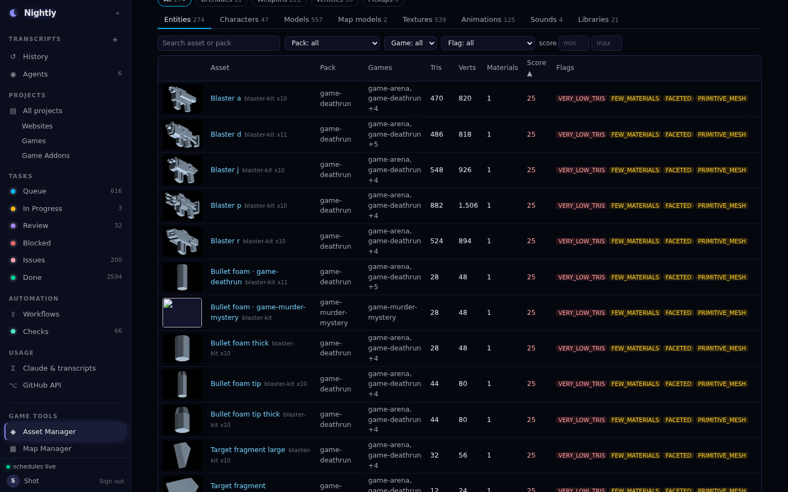
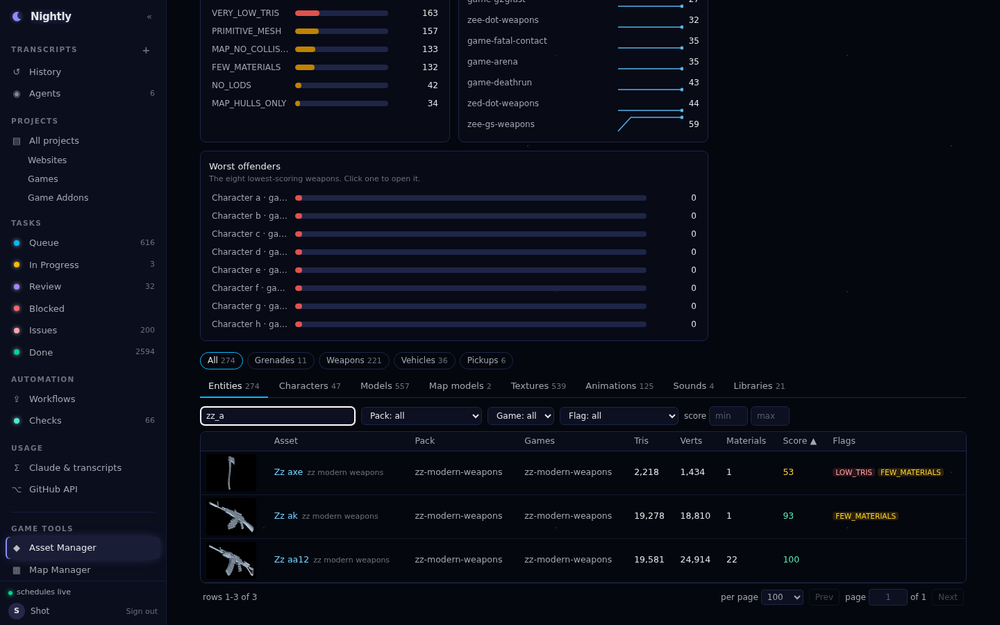
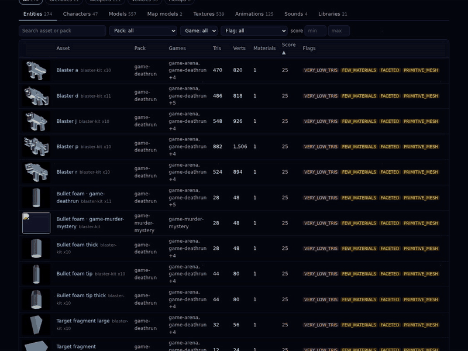
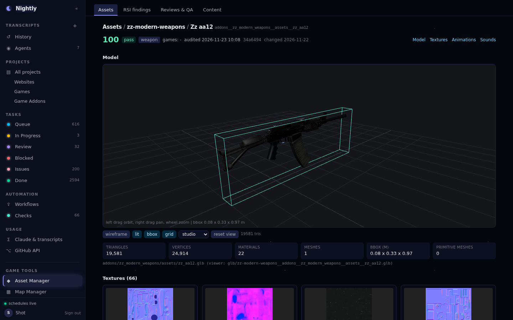
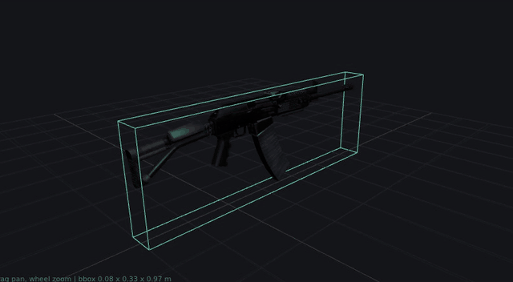
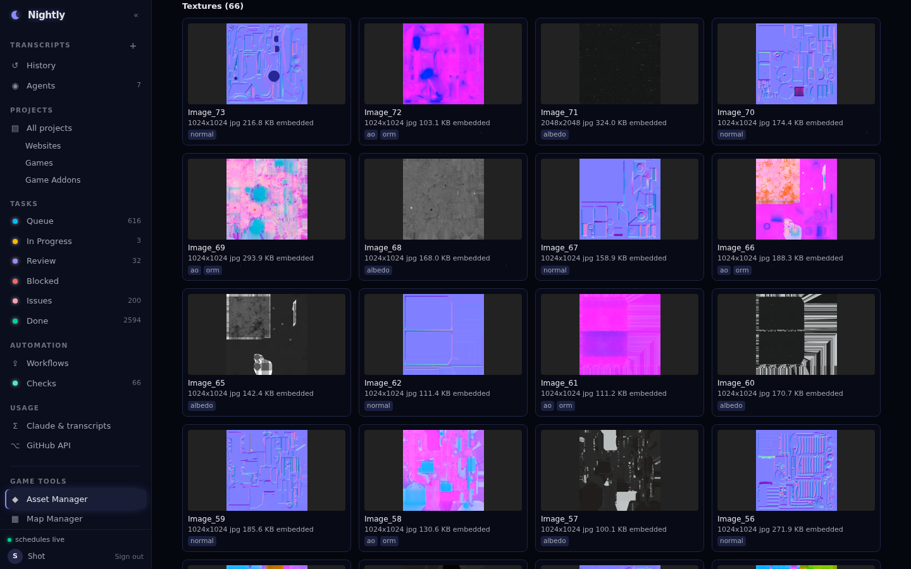
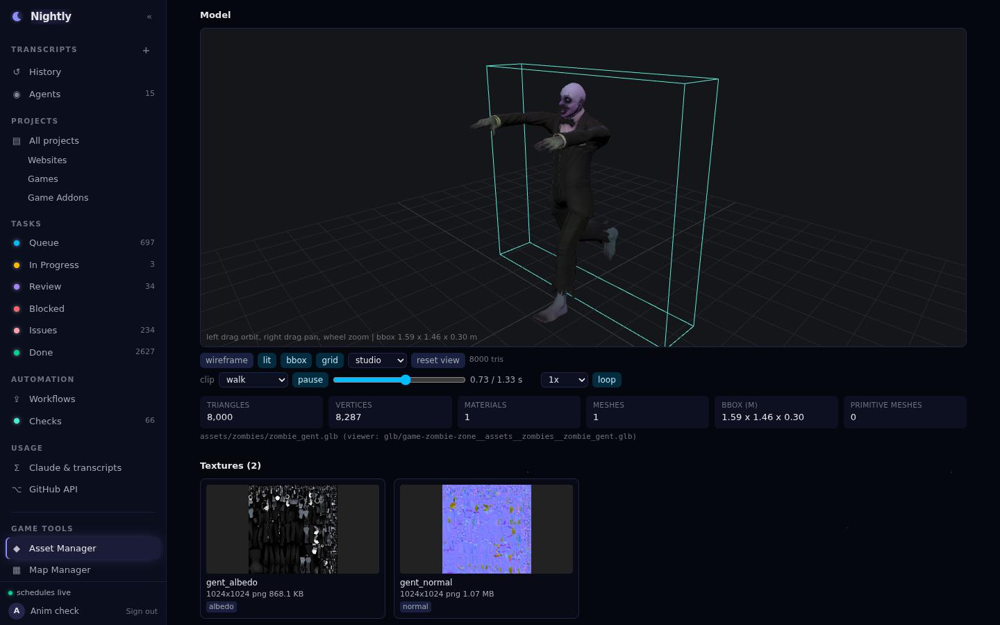
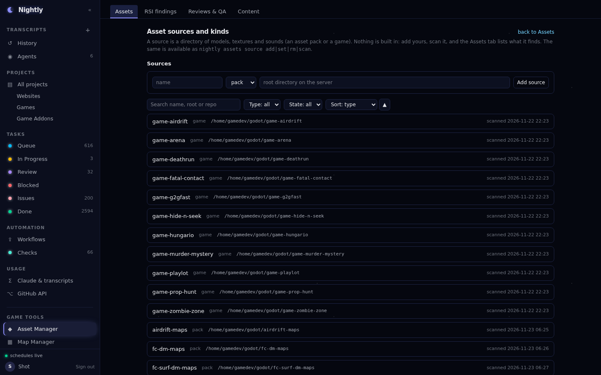

# Assets tab

- **Names, maps and libraries**: `lib/asset-names.mjs` turns a mangled id (`maps_world__.stores__model-library__dotmap__dm_applianceebox__dm_applianceebox`) into a short display name and defines `PIECE_SQL`: rows in a `*-maps` pack whose id has a `model-library` or `models` segment are map-embedded pieces. They stay out of Models/Textures/Animations/Sounds and their counts. The Maps tab lists real maps only and the Libraries tab lists library sets (Mini-market, Weapon-pack); both are one row per map or set across all packs (piece count, summed tris and textures, mean and worst score, flag union, packs in the Games column) and link to the individual pieces (`?tab=maps&pieces=1&grp=G`). Map thumbnails are left blank. Nothing is deleted or rewritten: dropping the `NOT PIECE_SQL` clause in `src/server/assetsList.ts` restores the old view. The full id stays in the hover title and on the detail page.
- **Entities and Models**: the first tab, Entities, holds gameplay things (kinds weapon, grenade, pickup, vehicle, viewmodel; arms are viewmodels, list in `ENTITY_KINDS` in `lib/asset-names.mjs`), Avatars (kind avatar, one row per avatar across games) is its own tab, the Models tab holds plain models (props, buildings, other). Kind chips follow the tab, and Entities, Avatars and Models together equal the old Models total.
- **Dedupe**: identical files shipped by many games (same `fileHash` and kind) are one row, with the canonical pack in Pack, every pack in Games (hover) and an `xN` copy count. Tab counts, kind counts, flags, bins and worst offenders count unique assets. Rows without a `fileHash` are not collapsed until `nightly assets thumbs --missing` fills it. Duplicate display names get the kind or pack appended. A model with no texture shows a "no texture" label.
- **Missing previews**: `nightly assets scan` and `assets ingest` spawn a detached `assets thumbs --missing` (only rows never rendered); `NIGHTLY_NO_AUTO_THUMBS=1` disables it. Run `nightly assets thumbs --missing` once to backfill existing rows.

`/assets` is the asset-quality side of RSI. It covers every kind of asset (weapons, props, avatars, pickups, grenades, vehicles, viewmodel arms, buildings, or kinds you define), with kind tabs and per-kind counts, tabs Models, Textures, Animations and Sounds, and a detail page `/assets/<id>` with a 3D viewer, textures, animations, sounds, flags and score. Nothing about your packs, games or budgets is built in: **sources** (directories to scan) and **kinds** (with audit budgets) are database rows, edited on `/assets/sources` or with the CLI. A fresh install shows a first-run guide until a source exists.

### Point it at your own game

1. `nightly assets migrate` (backs up the database first when there is work), then add a source: `nightly assets source add mygame --root /path/to/game --type game` (a pack is `--type pack`). Optional: `--models "**/*.glb"`, `--exclude .git,.godot`, `--default-kind prop`; `source set NAME ...` edits, `source list`, `source rm NAME [--purge]`.
2. `nightly assets source scan [NAME...]` (or `nightly assets scan`) lists every model, texture and sound of each enabled source (no hash de-duplication: the same file in two packs is two assets).
3. Kinds: seeded with generic defaults (weapon, prop, avatar, pickup, grenade, vehicle, arms, building, other). Edit labels, the `match` regex that classifies a path, and the budgets (tris range, texture size per tier, bones, required clips, scale, pivot, LODs) on the Sources page or with `nightly assets kind ...`. A source may also carry `kindRules` (`[{"match": "...", "kind": "..."}]`) in its config.
4. Quality audit: `nightly assets config > rsi-config.json` writes the `rsi-config/1` export (tiers, sources, kinds with budgets); run an auditor against it and `nightly assets ingest audit.json` (schema `rsi-assets/2`, an `assets` array with a `kind` each; the older `weapons` array is still accepted). The panel runs the script named by the `rsiAuditScript` setting on the refresh schedule. Findings land on the RSI board under the `models`, `textures`, `animations` and `sounds` domains, judged per video tier.
5. Local setup that must not live in this repository (your own pack names, event tables) belongs in a seed script that calls the CLI against your live database.

- **Ingest**: `nightly assets ingest FILE [--require-token|--token-only]`, or `POST /api/assets/ingest`; the audit's `glb/` directory is `NIGHTLY_ASSETS_DIR`.
- **Inspect**: `nightly assets list [--kind K --pack S --flag F --min-score N --max-score N --q TEXT] [--json]`, `assets show ID`, `assets summary`, `assets history [--pack P] [--limit N]` (the audit trend: one row per pack per ingest, oldest first, with total, pass count and average score; the history is kept per pack, not per kind).
- **Findings page**: `/rsi` lists the findings of the audited assets (models, maps, animations, textures at one tier, sounds), server-paged, with status, verdict (fail, unverified, pass) and the before-to-after score trend; it mirrors `nightly rsi board`.
- **Map originals converter**: a source's `mapOriginalConverter` (see `lib/map-originals.mjs`) is often a Python script. When it is run by a `python` interpreter, the scan first probes that the modules it imports (`mapOriginalPythonModules`, default `["numpy"]`) can be imported; if not, the scan log gets one line such as `map originals of NAME skipped: converter needs the Python module 'numpy', which python3 cannot import: install it (python3 -m pip install numpy) or point mapOriginalConverter at an interpreter that has it`, and original conversion is skipped for that source instead of failing per map. A converter that reports a missing module mid-scan stops the same way. Fix: install the module for that interpreter, or use an interpreter (for example a virtualenv's `python`) in the converter command, then rescan.
- Files are served by `/api/assets/file/<id>/<glb|tex|snd>/<index>` (Range supported, only from under a source root).


The map converter and map manager are covered in [map-converter](map-converter.md); the RSI audit settings are in [settings](settings.md).

## Asset manager reference

### List page



| Control | What it does |
| --- | --- |
| Kind chips (All, Grenades, Weapons, Vehicles, Pickups) | Narrow the current tab to one asset kind; the chips follow the tab. |
| Tabs: Entities, Characters, Models, Map models, Textures, Animations, Sounds, Libraries | One table per asset type, each with its own columns (Animations shows clips and total length). Counts are unique assets after de-duplication. |
| Search | Matches the asset name or pack. |
| Pack, Game, Flag | Filter by owning pack, by game using it, or by audit flag. |
| score min / max | Keep rows inside a score range. |
| Column headers | Click to sort; Score sorts ascending by default so the worst assets come first. |
| per page, Prev, Next | Server paging; the footer shows the row range. |
| Charts above the table | Most common flags (click one to filter), average score per audit per pack (a sparkline per pack) and the worst offenders (click to open). |





### Detail page and model viewer

`/tools/assets/<id>` shows the score, verdict, kind, owning pack, audit time and file hash, a stats strip (triangles, vertices, materials, meshes, bounding box, primitive meshes), then Model, Textures, Animations and Sounds sections.



| Viewer control | What it does |
| --- | --- |
| Left drag, right drag, wheel | Orbit, pan, zoom. |
| wireframe | Draw the mesh edges. |
| lit | Switch between lit and unlit shading. |
| bbox | Show the bounding box with its size in metres. |
| grid | Show the floor grid. |
| Lighting select | studio, outdoor, dark rim or flat. |
| reset view | Frame the model again. |



| Section | Shows |
| --- | --- |
| Textures | Every texture of the model with its size and map type. |
| Animations | Clips with length and whether they are static; procedural clips play in the viewer. |
| Sounds | Audio files with a player. |





### Sources and kinds



`/tools/assets/sources` adds, edits, scans and removes sources (the form takes a name, a type of pack or game, and a root directory), filters them by type and state, and edits the kinds with their match regex and audit budgets. The CLI equivalents are in [Point it at your own game](#point-it-at-your-own-game).

### Mapping to projects and packs

An asset belongs to a pack (the source it was scanned from). `nightly project map` links packs, and the maps in them, to projects (idempotent, `--dry-run` previews, `--json` for scripts). The Game column lists every game whose source ships the same file hash, so a shared file is one row with its copies counted.

### RSI findings

Every audit run turns each failing flag into a finding on the `/rsi` board under the `models`, `textures`, `animations` or `sounds` domain, with the before score. When a later audit no longer raises the flag the finding closes as remeasured and keeps both scores. The RSI findings tab next to Assets lists them; a flag chip in the asset list jumps to the assets carrying it.

### CLI and API summary

| Command | Purpose |
| --- | --- |
| `assets migrate`, `config` | Prepare the database, export `rsi-config/1`. |
| `assets source add/set/list/rm/scan`, `assets kind ...` | Manage sources and kinds. |
| `assets scan`, `assets ingest FILE`, `assets refresh` | Discover files, load an audit, recompute. |
| `assets list`, `show ID`, `summary`, `history` | Inspect. |
| `assets thumbs [--missing]` | Render previews. |
| `assets upload`, `assets uploads` | Add a file and list uploads. |
| `POST /api/assets/ingest` | Same as `assets ingest`. |
| `GET /api/assets/file/<id>/<glb\|tex\|snd>/<index>` | Serve a file with Range support. |

## Attachments

An attachment (scope, suppressor, grip, ...) is an asset of its own with kind `attachment`. A weapon links to it through the `AssetAttachment` table: the mount slot, a position/rotation (degrees)/scale in the weapon's model space, an optional node name and free `meta`. The asset page shows an "Attachments" list on a weapon, a "Fits" list on an attachment, and a picker under the model viewer that mounts one attachment per slot live.

A publisher sends the links in the ingest document next to `assets`:

```json
{"assets": [{"pack": "p", "weapon_id": "att_red_dot", "kind": "attachment", "model": {"glb": "build/nightly/att_red_dot.glb"}}],
 "attach_links": [{"pack": "p", "parent": "<model key or weapon_id>", "attachment": "att_red_dot", "slot": "optic", "pos": [0, 0.05, -0.1]}]}
```

Re-ingesting an attachment replaces its links; links whose weapon or attachment is unknown are returned as `unresolved`. fc-weapons publishes through its `tools/publish_nightly.sh`, which reads the numbers from the game's own tables.
