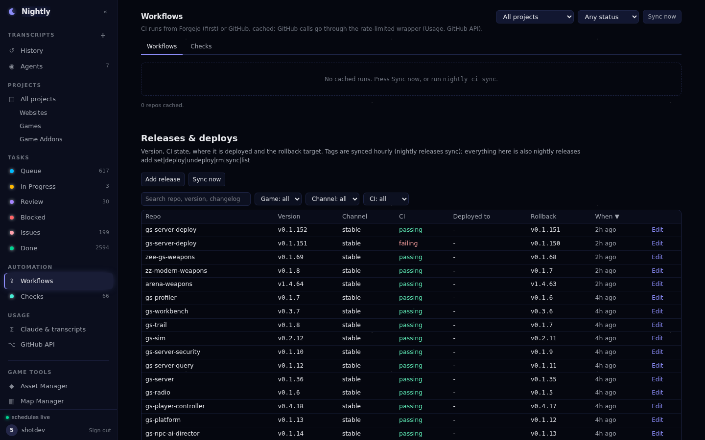

# Automation: schedules, runner, jobs

How a run starts, what the runner script does, and how an agent uses the board. Back to the [README](../README.md#automation).



## Scheduler
There is no cron job to set up. While the web panel is running, it checks every minute whether one of your schedules is due and starts it. The schedules themselves (when, which prompt, any extra instructions) are managed in the panel, and the **Schedules** page shows when the scheduler last checked in, with a warning if it has stopped.

Runs only start while the panel is up, so keep it running: the included systemd unit does that and starts it again after a reboot (see [Panel](#panel)). A run that has started keeps going if the panel is restarted.

If you would rather not depend on the panel being up, a crontab line does the same job, alongside the panel or instead of it. Two schedulers never start the same schedule twice.

```bash
# Optional: open your user's crontab.
crontab -e

# Add this line, using the path you cloned the repository to.
# tick.log only gets a line when a schedule fires or something breaks.
* * * * * /path/to/nightly/bin/nightly tick >> /path/to/nightly/data/tick.log 2>&1

# To use only the crontab, turn the panel's scheduler off in .env:
# NIGHTLY_SCHEDULER=off
```

## Runner script
The runner is the shell script each run executes. It decides whether it is safe to run and which repositories to leave alone, then starts Claude Code with your prompt. [`scripts/run.sh`](scripts/run.sh) is a complete one:

- Skips the run when your Claude plan usage is past the limits set in **Settings → Usage limits** (using the usage check below).
- Finds every Git repository in your workspace. A repository with uncommitted changes is handed to the agent to commit first, unless one of those files changed in the last 90 minutes; then somebody is mid-edit, and the agent is told to stay out of it.
- Adds the run's id, the agent board instructions and the schedule's own instructions to the prompt, then runs `claude -p` unattended.
- Sends Claude's final message, turn count, duration and cost back to the run in the web panel.

You can either store it in the database, which lets you edit it from the web panel (with history), or run the file in place.

```bash
# Store the included runner in the database (Prompts -> run.sh in the web panel).
bin/nightly prompt set run.sh --file scripts/run.sh

# Or run scripts/run.sh in place instead; edits then happen in the file.
bin/nightly set-setting runner scripts/run.sh
```

Nothing in the runner is specific to one machine. It is configured with environment variables, which you can put in `.env` (copy [`.env.example`](.env.example)); the CLI loads that file, so they also apply under cron.

Every variable the runner reads is in the [settings reference](settings.md#runner-environment).

> [!WARNING]
> By default the runner starts Claude Code with `--dangerously-skip-permissions`, so the agent can run any command as your user in the workspace. Only point it at repositories you are comfortable letting an agent change, on a machine you are comfortable letting it use.

## Jobs and scripts

A prompt is text an agent is told; a **job** is a runnable script (kind `script`, name ends `.sh`, first line `#!`). `/prompts` lists prompts (with a markdown preview), `/jobs` lists jobs. A prompt whose body starts with `#!` shows a `script` badge. A schedule runs a job with no agent, and the Schedules page shows a `job` or `agent` badge per schedule.

- Exit code contract: `0` ok, `1` findings (the check ran and found problems: run status `findings`, amber, the gates open RSI findings), anything else `failed` (infrastructure or a broken script).
- The job page shows the last run of its schedules, the linked schedule(s), the contract and a **Run now** button (same as `nightly start <schedule>`).
- Host, repository path and command are the first lines of the script (`REPO=`, `CMD=`), so they are edited on the Jobs page, never baked into the panel. `nightly prompt rename <old> <new> [--kind script]` keeps the history and the schedules' links.

## How a run starts

```
panel (every minute, src/server/scheduler.ts) and/or crontab:  nightly tick
           └─ each enabled schedule whose cron matches this minute (and doRun=true), claimed
              atomically so two tickers cannot both fire it:
              creates Run(status running, scheduleId) and spawns, detached:
nightly exec <run>
           └─ spawns the runner: the `run.sh` prompt (kind script) written to a private temp file,
              or a path in setting `runner` / env NIGHTLY_RUNNER;
              with NIGHTLY_RUN_ID, NIGHTLY_SCHEDULE_ID/NAME, NIGHTLY_PROMPT, NIGHTLY_INSTRUCTIONS,
              NIGHTLY_MAX_TURNS, NIGHTLY_TRIGGER; streams its stdout/stderr into Run.log every 5 s;
              a line `::nightly-meta {"turns":..,"minutes":..,"costUsd":..}` fills those columns;
              when it exits, closes the run (ok/failed by exit code) unless the agent already did.
```

A schedule that does not allow overlap, due while another run is alive, gets a `skipped` run saying so. Start from `scripts/run.sh` or write your own (Prompts → New, name it `run.sh`): decide what is safe, then `claude -p "$(nightly prompt show "$NIGHTLY_PROMPT")"`. `nightly exec` also passes `NIGHTLY_ROOT`, the repository's path.

## How the agent uses it

```bash
N=$HOME/stack/nightly/bin/nightly
RUN=$($N run start)                            # the run exec created
$N agent join nightly-$RUN --kind nightly --run $RUN --task "..."
#   before changing a repo: $N agent claim nightly-$RUN <repo>  (exit 3 -> someone is there; message them, move on)
# prompt gets:  $N brief   (and the run id)
#   the agent works top-down:  $N show <key>, $N set <key> --status in_progress,
#   $N note <key> --run $RUN "where it stopped / what was done", $N set <key> --status done,
#   $N checks --due -> do each -> $N checked <key> --run $RUN --note "...",
#   new work found -> $N add --title ... --after <key> --repos ... --done-when ...
$N run finish "$RUN" --status ok --summary "one line" --report-file /tmp/report.md
$N agent leave nightly-$RUN
```

Rules carried over from the Markdown list: work Queue top-down; an item that cannot be finished in one night goes to `in_progress` with a note saying exactly where it stopped; items are written to be picked up cold (repos, files, a checkable "done when"); only the owner removes a Queue item without doing it; never delete — close as `done`/`wontfix`.

## Agents liveness

`nightly agent join|heartbeat|leave` (or `POST /api/agents/heartbeat` with the ingest token) registers any runner. An agent is live for an hour after its last heartbeat, then stale, then left after the setting `agentLeftHours` (default 12). The Agents page lists a "Running (unregistered)" section from the setting `agentSourceCmd` (a command printing one agent per line) or `agentSourceFile`.
