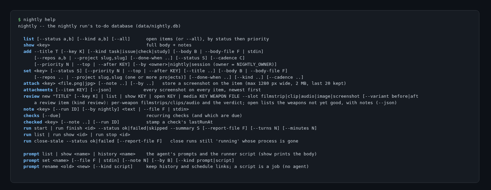

# CLI reference

`bin/nightly` works from any directory and under cron's bare `PATH` (it finds `/usr/local/bin/node` itself). Every command takes `--json`. `NIGHTLY_DB=/path/to.db` points it at another file. Back to the [README](../README.md#cli).



## Command groups

| Group | Commands | What it does |
| --- | --- | --- |
| Tasks | `list show add set note attach attachments checks checked brief` | The queue, items, notes and standing checks. |
| Runs | `run start|finish|list|show|stop|close-stale`, `schedule list`, `tick`, `start` | Runs and schedules. |
| Prompts | `prompt list|show|history|set|rename` | Prompts and job scripts, versioned. |
| Agents | `agent join|claim|release|say|inbox|board|leave|heartbeat|sweep|running` | The live board. |
| Projects | `folder`, `project list|show|add|set|rm|map|seed`, `access`, `loc` | Folders, projects, task mapping, lines of code. |
| Nodes | `node list|show|add|set|rm|token|probe|planet|import-ssh|users|links`, `dbconn`, `build`, `offload` | Hosts, databases, builds and offloads. |
| People | `user`, `role` | Logins, roles and grants. |
| Assets and maps | `assets ...`, `maps ...`, `map-convert ...`, `rsi ...` | Asset manager, map manager, converter, RSI board. |
| Perf and feeds | `perf ...`, `releases`, `crash`, `web`, `playtest`, `content`, `feed`, `gates` | Health feeds and gates. |
| Usage | `usage ...`, `account ...`, `transcript ...` | Token usage, Claude accounts, conversations. |
| Misc | `gh`, `ci`, `check`, `get`, `set-setting` | GitHub budget, CI, check scripts, settings. |

## Full command list

The text below is `nightly help` verbatim.

```text
  list [--status a,b] [--kind a,b] [--all]      open items (or --all), by status then priority
  show <key>                                    full body + notes
  add --title T [--key K] [--kind task|issue|check|study] [--body B | --body-file F | stdin]
      [--repos a,b | --project slug,slug] [--done-when ..] [--status S] [--cadence C]
      [--priority N | --top | --after KEY] [--by <owner>|nightly|session (owner = NIGHTLY_OWNER)]
  set <key> [--status S] [--priority N | --top | --after KEY] [--title ..] [--body B | --body-file F]
      [--repos .. | --project slug,slug (one or more projects)] [--done-when ..] [--kind ..] [--cadence ..]
  attach <key> <file.png|jpg> [--note ..] [--by ..]   store a screenshot on the item (max 1280 px wide, 2 MB, last 20 kept)
  attachments [--item KEY] [--json]            every screenshot on every item, newest first
  review new "TITLE" [--key K] | list | show KEY | open KEY | media KEY WEAPON FILE --slot filmstrip|clip|audio|image|screenshot [--variant before|after] [--label L] [--licence ..] [--source URL] [--title T] [--waveform W.png] [--look TEXT] [--metrics JSON] | verdict KEY WEAPON good|wrong [--note ..]
      a review item (kind review): per-weapon filmstrips/clips/audio and the verdict; open lists the weapons not yet good, with notes (--json)
  note <key> [--run ID] [--by nightly] <text | --file F | stdin>
  checks [--due]                                recurring checks (and which are due)
  checked <key> [--note ..] [--run ID]          stamp a check's lastRunAt
  run start | run finish <id> --status ok|failed|skipped --summary S [--report-file F] [--turns N] [--minutes N]
  run list | run show <id> | run stop <id>
  run close-stale --status ok|failed [--report-file F]   close runs still 'running' whose process is gone

  prompt list | show <name> | history <name>    the agent's prompts and the runner script (show prints the body)
  prompt set <name> [--file F | stdin] [--note N] [--by B] [--kind prompt|script]
  prompt rename <old> <new> [--kind script]     keep history and schedule links; a script is a job (no agent)

  schedule list                                 when the runner starts (edit in the panel)
  assets migrate                                create the assets (RSI) table (backs up the database to data/backup/ first)
  assets source add <name> --root DIR [--type pack|game] [--models GLOBS] [--textures GLOBS] [--sounds GLOBS] [--exclude DIRS] [--default-kind K] [--sound-kinds K,K] [--sound-match id-prefix|all|none] [--config JSON]
  assets source list|show <name>|set <name> [same flags, --disable|--enable]|rm <name> [--purge]|scan [name...]   asset sources (packs, games), stored in the database
  assets kind list|set <key> [--label L] [--sort N] [--match REGEX] [--budget JSON]|rm <key>   asset kinds and their audit budgets
  assets config                                 print the rsi-config/1 JSON (sources, kinds, tiers) the audit tool reads
  assets scan [name...]                         list every asset of the enabled sources by scanning their directories (never overwrites audited rows)
  assets ingest <audit.json|-> [--require-token|--token-only]   load rsi_asset_audit.py output (schema rsi-assets/2); token = NIGHTLY_PERF_TOKEN
  assets list [--pack P] [--kind K] [--game G] [--flag CODE] [--min-score N] [--max-score N] [--q TEXT] [--json]
  assets show <id|pack/weapon_id|weapon_id> [--json]     model, textures, animations, sounds, flags, score
  assets refresh                                run rsi_asset_audit.py for every texture tier (setting rsiTiers), ingest and sync findings (tick does this every rsiRefreshHours)
  rsi board|sync|refresh                        the RSI board: findings per domain; sync = stale/duplicate/blocked pass (auto-closes non-owner stale items)
  assets thumbs [id...] [--force] [--missing] [--limit N] [--wait]   (re)generate the 128x96 webp thumbnails (textures downscaled, models rendered in software, cached beside the audit data, regenerated when the file hash changes); runs detached unless --wait
  assets history [--pack P] [--limit N] [--json]   audit trend: one row per pack per ingest (oldest first; the history keeps counts and average score per pack, not per kind)
  assets summary                                per-pack counts and average score
  transcript list [--q S] [--limit N] [--all] [--as USER]   Claude Code conversations, newest first (--all adds subagent threads)
  transcript show <id|session> [--tail N] [--full] [--json]   print a conversation (default: the last 20 entries)
  transcript start --prompt P [--cwd DIR] [--model M] [--effort E] [--mode default|acceptEdits|plan|auto|bypass] [--resume ID] [--fork] [--as USER] [--wait] [--user-id N]
                                                start claude (subscription login, sudo -u USER when it is not you); --wait prints the answer
  transcript send <id|session> <text|-> [--wait]   continue a conversation: into its live run, else a new --resume run
  transcript stop <id|run> [--interrupt]        stop the run (or only interrupt the current turn)
  transcript runs [--all]                       claude processes started from here
  transcript agents [--json]                    subagent threads with their parent and tool/token totals
  transcript ingest [--dir D]                   refresh the index from the session files (read-only; tick does this too)
  usage ingest [--full] [--dir D] [--no-ch] [--resync]   read Claude Code transcripts (usageDirs setting, default ~/.claude/projects) into the usage tables; pushes to ClickHouse when enabled
  usage summary [--days N] [--source ch]        tokens and estimated cost today/7d/30d/all
  usage top <project|session|agent_type|model|skill|tool|branch> [--days N] [--limit N] [--source ch]   biggest consumers
  usage cost [--days N]                         estimated cost by model     usage insights [--days N]   where the tokens go, with suggestions
  usage status | usage ch-setup                 what is configured / create the ClickHouse database and tables (never prints the password)
  perf migrate                                  create/upgrade the perf tables (backs up the database to data/backup/ first)
  perf token add --name N [--game G]            ingest token for one runner/game; the secret is printed once, only its hash is kept
  perf token list | perf token revoke NAME      (HTTP ingest needs "Authorization: Bearer <token>" once a token exists)
  perf gate --game X [--run ID|latest|COMMIT] [--no-budgets] [--no-baseline] [--noise-pct N]   pass/fail vs budgets and the noise-aware baseline; exit 0 pass, 1 fail, 2 no run
  perf report <runId> [--out DIR] [--png]       per-run perf report: markdown + svg (+ png via headless chromium) for READMEs/PRs
  perf diff <runA> <runB> [--out DIR] [--png]   differential flame graph (red = slower in B, green = faster) + the biggest changes
  perf shot add --run ID FILE.png [--name N] | perf shot list --run ID    screenshots attached to a run
  perf rsi [--game X]                           findings with state found -> fixed -> remeasured and the before/after delta
  perf game add --id X --name N [--repo R] [--repo-path DIR] [--engine godot] [--platforms native,web] [--owner O]
      [--budget "frame_ms_p95<=33@platform=native,role=client,map=arena,bots=4"]... [--routing JSON] [--addons JSON]
  perf game set --id X [same flags; --budgets JSON replaces the list] | perf game list | perf game show X
  perf ingest <report.json|.folded|.txt|-> --game X [--platform native|web] [--role client|server] [--map M] [--bots N]
      [--commit SHA] [--gpu S] [--resolution WxH] [--label L] [--register] [--no-findings] [--folded FILE]   (a v1 report plus its .folded gives the icicle view)
  perf run --game X [--platform native|web] [--role client|server] [--map M] [--bots N] [--dry-run]   runs tools/perf.sh, ingests
  perf nightly [--game X] [--dry-run]            the scheduled run: every routing entry of every enabled game
  perf runs [--game X] [--limit N] | perf compare <runA> <runB> | perf findings [--game X]
  perf finding add --game X --metric M [--item KEY | --title T]   link a perf finding to a queue item
  releases list|add|deploy [--repo R] [--version V] [--channel C] [--ci passing|failing|pending] [--to ENV] [--changelog T] [--rollback V] [--game G]
  releases set --repo R --version V [--channel C] [--changelog T] [--ci S] [--rollback V] [--game G] [--commit SHA] [--at DATE]   edit a release (the panel's Edit)
  releases undeploy --repo R --version V --from ENV    remove an environment from a release     releases rm --repo R --version V [--channel C]   delete a record
  releases sync [--no-ci]                       import v*.*.* tags of every repo under setting releasesRoots (default gamedev ~/godot and core ~/projects) and fill CI from GitHub; idempotent, never touches deployedTo (the Releases schedule runs it hourly)
  <kind> edit <id> [--field value ...]           change fields of one row (ids come from list); <kind> delete <id>   remove it. Same functions as the panel's Edit / Delete.
  crash list|add|edit|delete|summary|set|scan [--from FILE|-] [--game G] [--signature S] [--version V] [--platform P] [--count N] [--status open|fixed|ignored]
  crash scan [--logs DIR,DIR] [--no-journal] [--since 90d]   import engine crash dumps and OOM kills as absolute counts (idempotent; run as the user owning the logs)
  web (alias webcheck) list|add|edit|delete|budget|probe|summary --game G --metric M [--value N] [--max N --unit U] [--url U] [--commit C]     bundle size, web vitals, uptime as budgeted series
  playtest record --game G --from-soak <file|-> [--mode M] [--build B] | --map M --bots N --duration_s S --result pass|fail --crashes N --avg_fps F   post one unattended bot run (tester bots); idempotent
  playtest import-perf                          every perf run with bots becomes a bot playtest (history; idempotent)
  playtest list|add|edit|delete|summary --game G [--build B] [--tester T] [--rating 1-5] [--tags a,b] [--text T]
  content scan [--packs game=dir,...]            read the weapon definitions of each game's weapon pack (setting contentWeaponPacks) into stats: damage, max_range, spread, magazine, fire_rate_rpm; bands are never invented
  content list|add|edit|delete|summary --game G --name N --metric M --value V [--category C] [--min N] [--max N]     balance stats; outside [min,max] opens a finding
  feed add <kind> <file|->                      ingest one JSON record or an array (HTTP: POST /api/ingest/<kind> with Authorization: Bearer <perf token>)
  gates sync --kind perf|visual|netchaos --game G [--file qa.json|-]    open/close one RSI finding per failing check of a gate result

  Users, projects and nodes (the panel's AdminCP does the same):
  user list | show U | add U [--name N] [--roles a,b] [--password-stdin | --password P] | set U [--name N] [--roles a,b] [--password-stdin | --password P] [--disable | --enable] | rm U
      panel logins (scrypt); no password given = a random one printed once; disabling or a new password ends the user's sessions; the last enabled admin cannot be removed
  user perms U                                  the user's effective permissions (role grants + user allow/deny)
  role list | add NAME [--description D] [--grants a,b] | rm NAME | grant role:NAME|user:U PERM [allow|deny|revoke] | perms
      roles admin (everything) and user are builtin; PERM is a key from `role perms` or a wildcard like tools.* (deny wins; roles only allow)
  folder list | add NAME [--parent ID|PATH] [--sort N] | set ID|PATH [--name N] [--parent ID|PATH|-] [--sort N] | rm ID|PATH
  project list [--type website|game|game-addon] [--folder ID|PATH] [--q TEXT] | show SLUG | add SLUG [--name N] [--type T] [--folder F] [--repo-path P] [--repo-url U]
  project set SLUG [--name ..] [--type ..] [--folder F|-] [--repo-path ..] [--repo-url ..] [--settings JSON] [--archive | --unarchive] | rm SLUG
  project map [--dry-run] [--json] [--remap-tasks]   link tasks (Item.repos -> ItemProject, many per task), asset packs and maps to projects; idempotent. --remap-tasks re-resolves every task, not only unlinked ones
  project seed [--roots a:b] [--dry-run]         create projects from the repos under setting projectRoots (and those the DB knows); idempotent
  access list | grant user:U|role:R project:SLUG|folder:ID|PATH [--perms projects.view,projects.edit] | revoke ID     folder access covers subfolders
  node list | show N | add NAME [--type planet|station] [--host H] [--port 4001] [--tls] [--specs JSON] [--notes T] | set N [..] | rm N
  node token N                                  rotate the node token (printed once; stored as sha256)
  node probe [N] | planet                       probe this machine's cpu/ram/gpu/disks into N (default: the planet) | create the planet if missing
  node import-ssh ALIAS [--name N] [--config FILE]   a station from an ssh config Host (host/user/port only; no credentials read)
  node users N | node user-add N U [--os-user X] | node user-rm N U | node links | node link FROM TO OS_USER [--auth ssh-key|password] | node unlink ID
  dbconn list | add NAME [--kind clickhouse|postgres|mysql|sqlite] [--host H] [--port P] [--database D] [--username U] [--secret-ref ENV_NAME] | rm NAME
  build list [--project SLUG] | set SLUG NAME --command C [--heavy] [--node-kinds build,gpu] [--timeout S (0 = unlimited)] [--disable | --enable] | rm SLUG NAME
  assets upload <file> [--type model|texture|sound|animation|map|other] [--pack P] [--name N] [--note T] [--project SLUG] [--by USER] [--no-scan]   store an asset (validated, size limits from settings uploadMaxMb[.type], 0 = unlimited), convert if needed, scan
  assets uploads [--pack P] [--type T]          list uploaded files
  maps list [--pack P] [--q TEXT]               converted maps (name, pack, triangles, spawns)
  maps upload <file> [--bin FILE] [--pack P] [--name N] [--note T] [--by USER]   add a map: GameSpice manifest .json (+ --bin), BSP, VMF, Quake .map, glb, obj; converted to a GameSpice map and scanned
  map-convert <file> --to <fmt> [--bin FILE] [--project SLUG] [--by USER] [--wait] [--json]   convert a map (bsp, vmf, quake-map, gs-map, glb, obj, ...) as a job; prints the job id (--wait runs it here; --bin: a gs-map manifest's geometry when not beside it)
  map-convert --jobs [--project SLUG] | --job <id> | --formats | --run-job <id>   list jobs, show one, list the registered converters and what is unavailable, or run a queued job (the panel does this detached)
  gh status | calls [--limit N] | sample                 GitHub API budget: remaining per bucket (core/search/graphql), reset times, the recorded calls; sample stores a point (tick does hourly)
  ci sync [--repo owner/name] [--force] | list [--repo R] [--status S] | rerun|cancel <owner/name> <run_id>   CI workflows/runs: Forgejo first, GitHub (rate-limited via the gh wrapper) otherwise; cached (setting ciTtlMin)
  check scripts | add|edit <name> [--script chk-x.sh] [--args A] [--interval MIN] [--disable] [--item KEY] [--note T] | rm <name> | run <name> | runs [name] | due <item-key>   scripts/chk-*.sh checks with schedule; due = run an item check now
  offload run <id> | list [--kind K] [--project P] | show <id> | start playtest --project P [--target planet|station] [--map M] [--bots N] [--duration S] [--by WHO] [--node NAME] | mark <id> running|error [--node N] [--message M] | finish <id> --code N (log on stdin)   offload seam (playtest); run is the detached child, --node/mark/finish are the panel's node scheduler
  loc [PROJECT | --all] [--folder F] [--force] [--no-ch] [--json]   lines of code (scc): scan the project path(s), cache in the database (rescans only when the git HEAD changed, or --force),
      mirror to ClickHouse loc_history; with no project, print the cached overview with folder roll-ups. scc: setting sccPath | env NIGHTLY_SCC | PATH | ~/bin/scc; tick rescans every locRefreshHours (default 24, 0 = never)
  tick [--dry-run]                              crontab, every minute: fire the schedules due now
  start <schedule-id|name>                      fire one schedule now (ignores doRun); prints the run id

  agent join <name> [--task T] [--repos a,b] [--kind session|nightly] [--run ID]
  agent claim <name> <scope...> [--note N] [--force] [--item KEY] [--why W]
      exit 3 if a live agent holds an overlapping scope.
      scope = path, or <repo-claim>:<path-or-glob> (myhost:org/repo:scripts/**); a bare repo = whole repo
      Relaunch guard, on an agent's first claim: its item (--item, or an item key in its task) must not have another
      live agent, and the last agent on it must have left a commit sha (messages, leave note or item notes); else exit 4
      with that agent's stop note, unless --why says what changed (posted to the board).
  agent release <name> [<scope...>]              (no path = all of them)
  agent say <name> [--to AGENT] <text | stdin>
  agent inbox <name> [--peek]                   messages for you since you last looked
  agent board                                   who is live, what they hold, recent messages
  agent leave <name> [--note N]                 releases everything
  agent heartbeat <name> [--task T] [--kind K] [--repos a,b] [--leave]   register-or-refresh from any runner (HTTP: POST /api/agents/heartbeat)
  agent sweep | running                         retire agents silent past the agentLeftHours setting (12h) | list running agents that never registered
                                                (settings agentSourceCmd = a command, or agentSourceFile = a file; JSON array or "name task" lines)

  account status | pick | env | add <name>      which Claude account a run or session uses (scripts/claude-acct); set up in .env
      [--strict] [--exclude a,b]                pick/env only: exit 1 if no account is under its limits / leave these out
  get <setting>            (get doRun prints exactly true/false)
  set-setting <key> <value>
  brief                                         compact digest for the nightly prompt

  Every command takes --json.
```

## Notes

- `list` shows open items (in progress, review, queue, blocked) ordered by status then priority; standing checks only appear with `--kind check` or `--all` (use `nightly checks`).
- `add` without `--key` makes a slug from the title (`spy-go-1` style). Default position is the bottom of its list; `add` defaults `--by nightly`.
- `set --status done|wontfix` fills `completedAt`; moving back clears it.
- A check is due when `lastRunAt` is older than 20 h (nightly), 6.5 days (weekly) or 28 days (monthly).
- `run finish`/`close-stale` store the report file truncated to ~200 KB. `close-stale` leaves runs whose process is still alive.
- `run start` under `nightly exec` prints the run `exec` created (`NIGHTLY_RUN_ID`) instead of making a new one.
- Agent paths are relative to the workspace (the directory holding this repo); `~/stack/x/` and `x` are the same claim. Two claims overlap when one path contains the other; `*` is everything. An agent silent for 60 min no longer blocks anyone; after 6 h `tick` ends it and releases its claims.

## Agent claims and exit codes

```bash
nightly agent claim NAME PATH...   # exit 3: a live agent holds an overlapping path
                                   # exit 4 (first claim only): the relaunch guard, prints its stop note;
                                   # read it, change the brief, then pass --why "<what changed>"
nightly get doRun                  # prints exactly true or false
```

Perf-specific commands, flags and the CI gate are in [perf.md](perf.md); node commands in [nodes.md](nodes.md); usage in [usage.md](usage.md).
