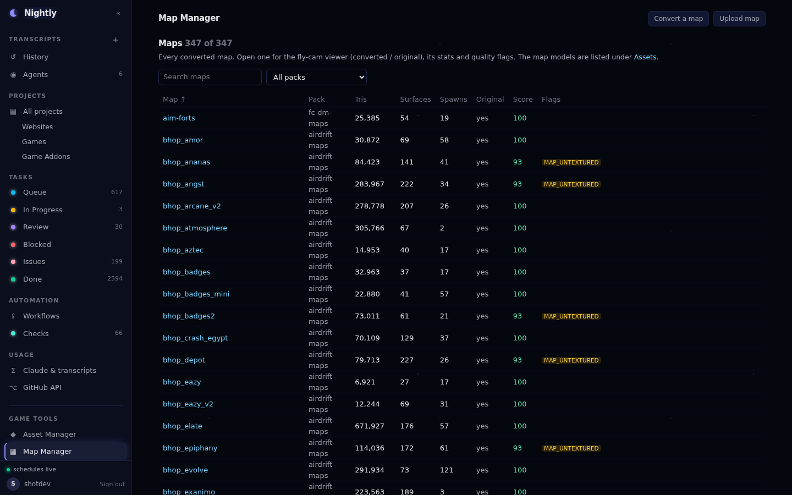

# Map converter and map manager

Convert maps between engine formats as queued jobs. Jobs live in the table `map_convert_job`; the panel starts them detached, a node with the `map-convert` kind can run them, and the CLI can run one in the foreground.

## Formats

| From | To | Needs |
| --- | --- | --- |
| `bsp` | `gs-map` | The `gs-map-convert` checkout (`bsp.py`). Not bundled: set `mapConverterPath`, `$GS_MAP_CONVERT_PATH` or `$GSBSP_PATH`. |
| `gs-map` | `glb`, `vmf`, `quake-map` | Nothing extra. |
| `vmf`, `quake-map`, `obj`, `glb` | `gs-map` | Nothing extra. |
| `fbx`, `dae` | `glb` | Nothing extra. |
| `gs-map` | `bsp` | A compiler: set `mapCompiler` (argv template with `{input}`, `{outDir}`, `{name}`). Without one the result is the `.vmf` only, with a warning. |

`nightly map-convert --formats` lists what is registered and what is unavailable on this machine, and why.

## CLI

| What | Command | Notes |
| --- | --- | --- |
| Convert | `nightly map-convert FILE --to FMT [--bin FILE] [--project SLUG] [--by USER] [--wait] [--json]` | Prints the job id; `--wait` runs it here. |
| List jobs | `nightly map-convert --jobs [--project SLUG]` | |
| Show one | `nightly map-convert --job ID` | |
| Run a queued job | `nightly map-convert --run-job ID` | What the panel does detached. |
| Formats | `nightly map-convert --formats` | |
| List maps | `nightly maps list [--pack P] [--q TEXT]` | Converted maps: name, pack, triangles, spawns. |
| Upload | `nightly maps upload FILE [--bin FILE] [--pack P] [--name N] [--note T] [--by USER]` | GameSpice manifest `.json` (+ `--bin`), BSP, VMF, Quake `.map`, glb, obj; converted and scanned. |

## Settings

The `mapOriginal*` keys are per-source config of an asset source (`nightly assets source set NAME ...`, see [assets](assets.md)); the rest are panel settings.

| Setting | Default | Meaning |
| --- | --- | --- |
| `mapConverterPath` | empty | Directory of the `bsp.py` converter checkout. |
| `mapCompiler` | none | Argv template that compiles a VMF to BSP. |
| `mapOriginalConverter` | none | Command that converts a source's original maps (often a Python script). |
| `mapOriginalPythonModules` | `["numpy"]` | Modules probed before the converter runs; a missing one skips the source with a one-line hint. |
| `mapOriginalRoots`, `mapOriginalMatch` | none | Where originals live and which files count. |
| `mapOriginalTimeoutSec` | 300 | Time limit per conversion. |
| `mapModelRoots`, `mapPbrRoots`, `mapCompanions` | none | Where models, PBR textures and companion files are found. |

## Map manager

Lists converted maps per project with triangle and spawn counts and opens them in a viewer; it reads the same tables `nightly maps list` prints. Full reference: [map-manager](map-manager.md).
