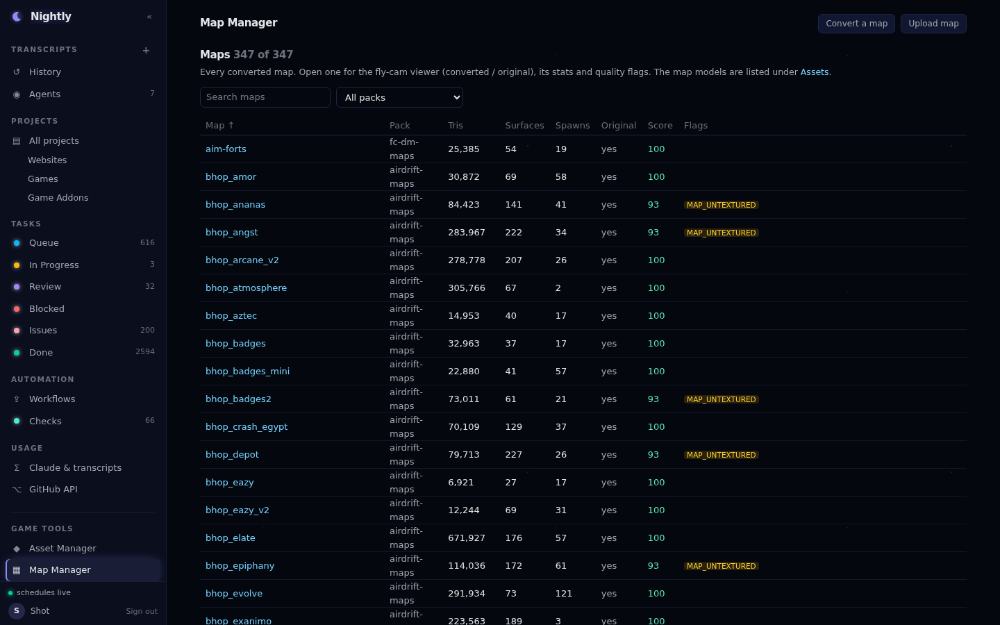
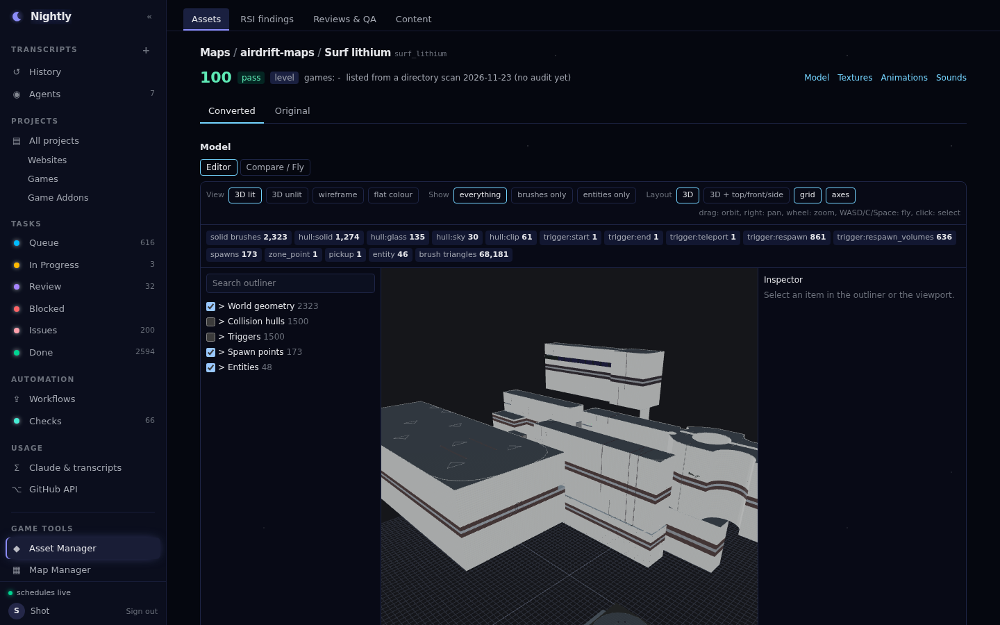
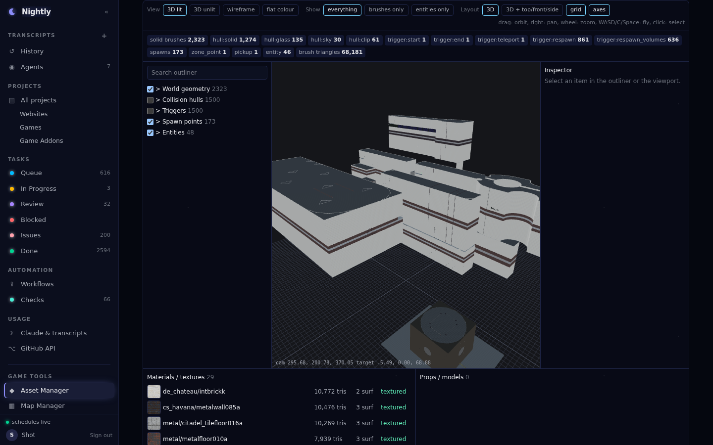
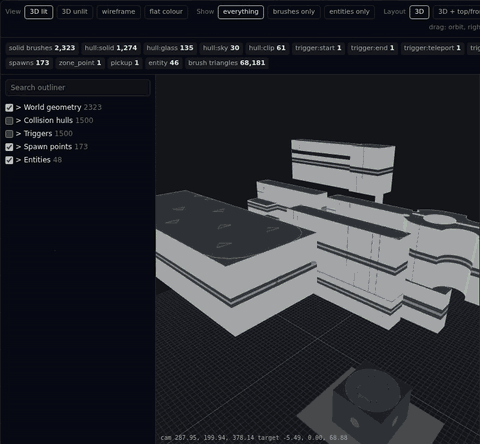
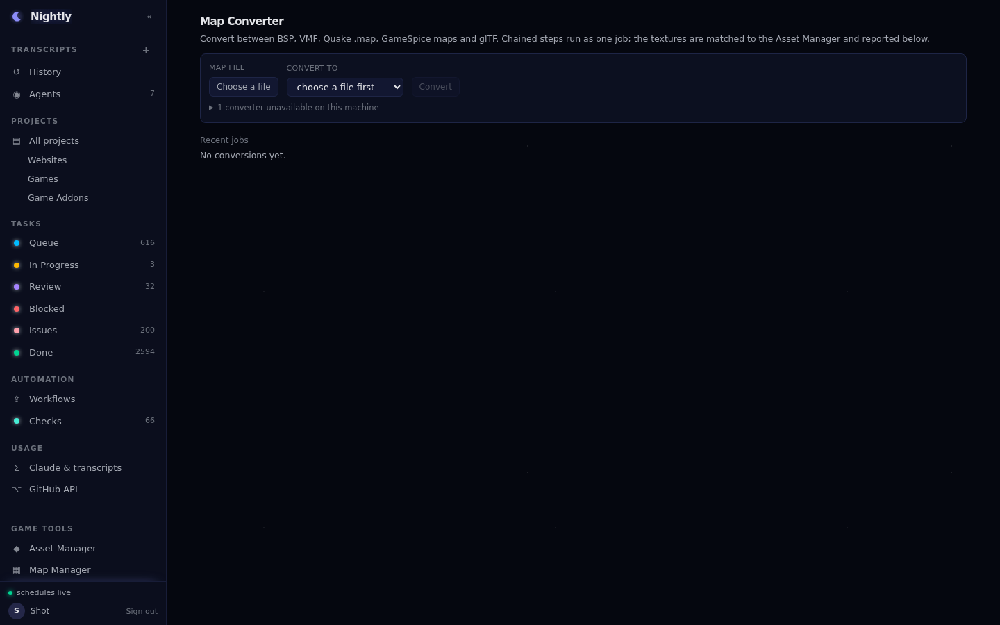

# Map manager

Every converted map per pack, with a fly-camera viewer, a full map editor view, original-versus-converted comparison and quality flags. Converting and uploading are covered in [map-converter](map-converter.md); this page is the reference for the manager itself.

## Map list

| Control | What it does |
| --- | --- |
| Search maps | Filter by map name. |
| Pack select | Show one pack's maps. |
| Columns Map, Pack, Tris, Surfaces, Spawns, Original, Score, Flags | Click a header to sort. Original says whether an original-format file exists; flags such as `MAP_UNTEXTURED` come from the audit. |
| Convert a map | Opens the converter form (see [map-converter](map-converter.md)). |
| Upload map | Adds a manifest, BSP, VMF, Quake `.map`, glb or obj file; it is converted and scanned. |

## Map page

`/tools/assets/<id>` for a map shows the score, a Converted and Original tab, and two modes: Editor and Compare / Fly.

## Editor mode

| Control | What it does |
| --- | --- |
| View: 3D lit, 3D unlit, wireframe, flat colour | Shading of the geometry. |
| Show: everything, brushes only, entities only | What is drawn. |
| Layout: 3D, 3D + top/front/side | One viewport or a four-pane layout. |
| grid, axes | Toggle the floor grid and axes. |
| Kind strip | Counts per kind (solid brushes, hull:solid, hull:glass, hull:sky, hull:clip, triggers, spawns, entities, brush triangles). |
| Outliner | Tick groups (World geometry, Collision hulls, Triggers, Spawn points, Entities) to show them; expand for visgroups; the search box filters items. |
| Inspector | Properties of the item selected in the outliner or by clicking it in the viewport. |
| Materials, Props panels | Materials used and placed props. |
| Mouse | Drag orbits, right drag pans, wheel zooms, WASD/C/Space fly, click selects. |

## Compare / Fly mode

The viewer toolbar has fly or orbit navigation, toggles for collision, triggers and spawns, a jump-to-spawn select, and converted, original and split views, so a conversion can be checked against the source map side by side.

## Mapping to projects and packs

A map belongs to the pack (source) it was scanned from. `nightly project map` links packs and their maps to projects; the list and CLI can be filtered by pack.

## RSI findings

Map audits raise flags (for example `MAP_UNTEXTURED`, `MAP_NO_COLLISION`, `MAP_HULLS_ONLY`) that become findings in the `models`/maps domain of the [RSI board](panel.md#rsi-board-home-page); they close as remeasured once a later audit no longer raises them.

## Converter status

The status panel lists the available converters, the ones unavailable on this machine and why, and the recent conversion jobs.

## CLI

| Command | Purpose |
| --- | --- |
| `nightly maps list [--pack P] [--q TEXT]` | Converted maps. |
| `nightly maps upload FILE [--bin FILE] [--pack P] [--name N] [--note T] [--by USER]` | Add and convert a map. |
| `nightly map-convert ...` | Conversion jobs, see [map-converter](map-converter.md). |
| `nightly project map` | Link packs and maps to projects. |
