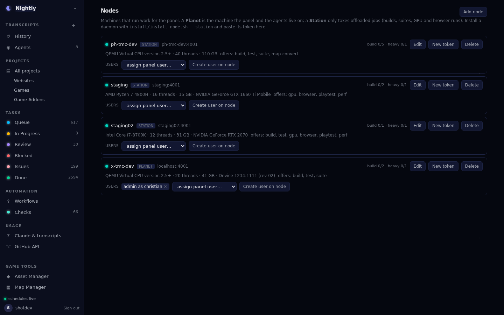

# Nodes

A node is a machine the panel knows about. There are two types, set when it is added.



| Type | What it is | Runs |
| --- | --- | --- |
| `planet` | The machine the panel and the agents live on. Created by `nightly node planet` (the migration and the Docker entrypoint do it too). | Everything local; also takes offloads. |
| `station` | An offload box that runs jobs for the panel and nothing else. | Only the kinds it advertises. |

## Specs

Each node carries a JSON `specs` object, checked by `lib/node-specs.mjs`; `nightly node probe` fills the hardware part for this machine.

| Spec | Default (local probe) | Meaning |
| --- | --- | --- |
| `cpu`, `ram`, `gpu`, `disks`, `os` | probed | Hardware shown on the node card (`lspci`, `lsblk`, `/proc/cpuinfo`; missing tools give empty fields, never an error). |
| `buildSlots` | `max(1, floor(threads / 8))` | Builds that may run at once. A whole number, 0 or more. |
| `heavySlots` | 1 | Heavy jobs (suites, GPU runs) at once. |
| `offloadKinds` | `build, test, suite` | Which kinds of work the node accepts, see below. |
| `workspace` | none | Absolute directory on the node where jobs run. |
| `projectPaths` | none | `{ project slug: absolute path }` of each checkout on the node. |

## Offload kinds

| Kind | Work |
| --- | --- |
| `build` | Project build commands (AdminCP, Builds). |
| `test` | Unit tests. |
| `suite` | Full test suites. |
| `gpu` | Jobs that need a GPU. Only assign these to a node that has one. |
| `browser` | Playwright and web checks. |
| `perf` | Performance benchmarks. |
| `map-convert` | [Map converter](map-converter.md) jobs. |
| `playtest` | Bot playtests (`offload start playtest`). |

## Tokens, ports and links

| What | Command / where | Notes |
| --- | --- | --- |
| Token | `nightly node token N` | Printed once; only the sha256 is stored. |
| Port | `--port`, default `4001` | The daemon (`bin/nightly-node`) listens here; add `--tls` for wss with a self-signed certificate. |
| Registering | Panel, AdminCP, Nodes, or `nightly node add NAME --type station --host H --port 4001` | Paste the token the install printed. |
| Probe | `nightly node probe [N]` | Probes this machine into node N (default: the planet). |
| ssh import | `nightly node import-ssh ALIAS` | Reads host, user and port from an ssh config Host; no credentials are read. |
| OS users | `nightly node users N`, `user-add N U [--os-user X]`, `user-rm N U` | Which panel users may act on the node, and as which OS account. |
| Links | `nightly node links`, `link FROM TO OS_USER [--auth ssh-key|password]`, `unlink ID` | How one node reaches another (planet to station). Only the auth kind is stored. |
| Offloads | `nightly offload list|show|run|start|mark|finish` | Queue of jobs sent to nodes. |

Link auth is `ssh-key` or `password`; the panel never stores key material or passwords. Database connections (`nightly dbconn`, AdminCP, Databases) follow the same rule: they store a `secretRef`, the name of an env var or file, never the secret (kinds `clickhouse`, `postgres`, `mysql`, `sqlite`).

## Installing the daemon

```bash
sudo install/install-node.sh --station --name builder-1 --kinds build,test,suite
sudo install/install-node.sh --planet [--panel]
install/install-node.sh --station --dry-run     # print what would be done
sudo install/install-node.sh --uninstall [--purge]
```

The script is idempotent, keeps an existing token, and installs `deploy/nightly-node.service` as a systemd unit. Options: `--name`, `--port`, `--token`, `--kinds`, `--workspaces`, `--tls`, `--panel` (planet only), `--user`, `--prefix DIR` (staging, skips systemctl), `--no-systemd`, `--dry-run`.
