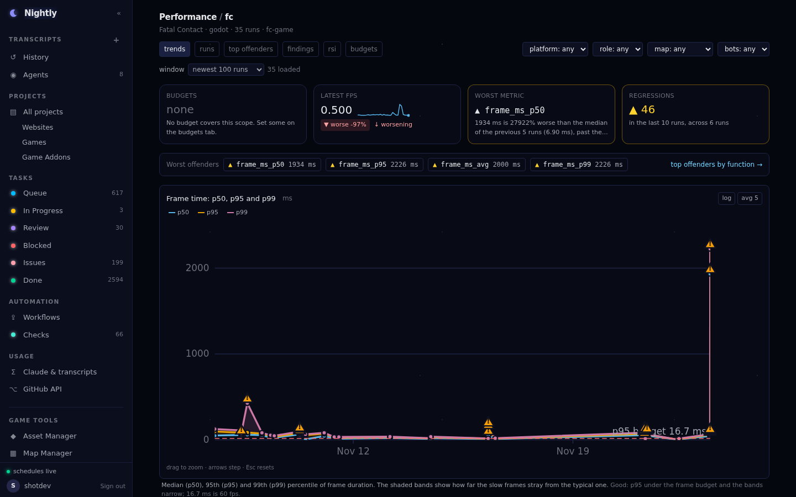
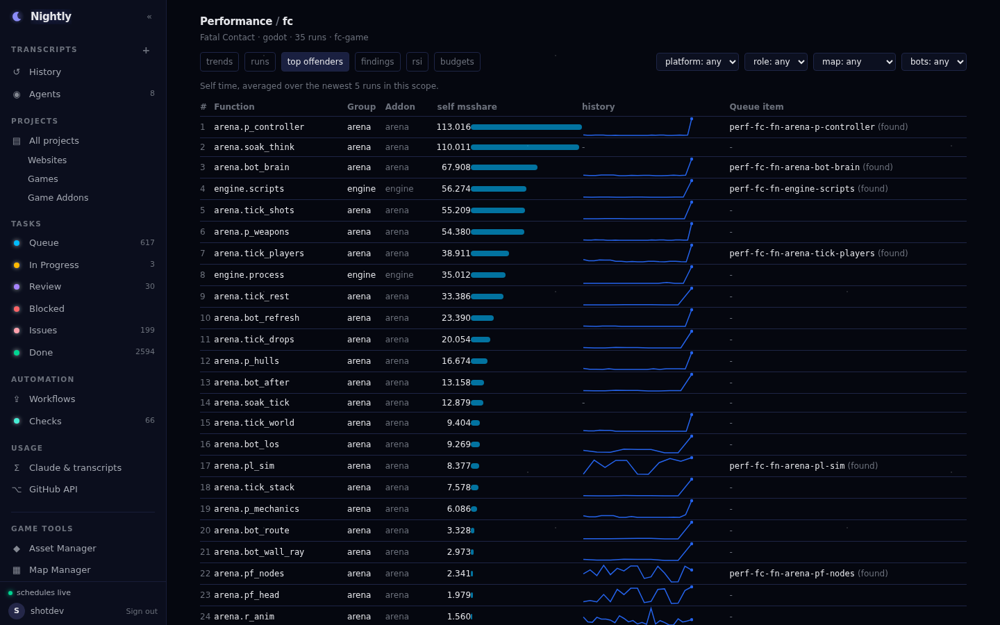
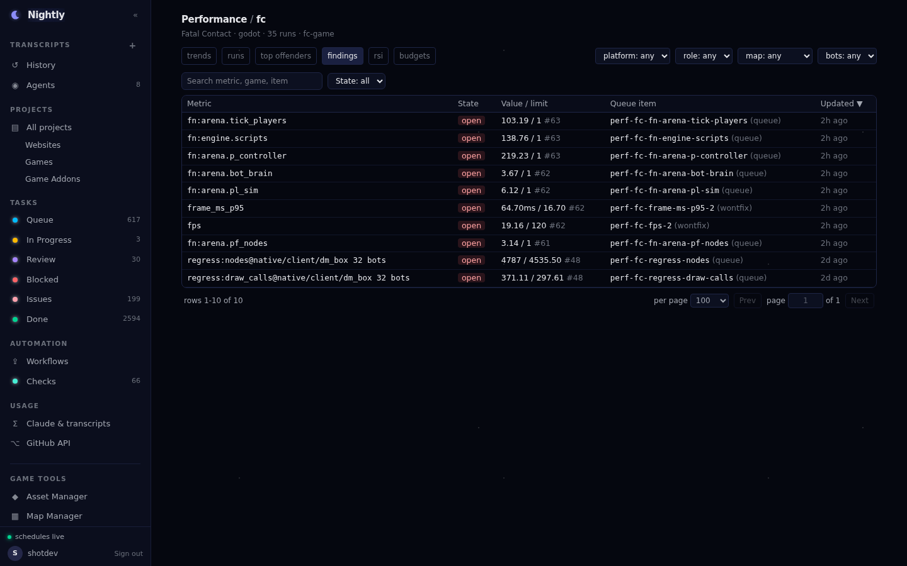

# Performance

Per-game benchmark runs, profiler reports, budgets, regressions, offenders and the find, fix, remeasure loop. Back to the [README](../README.md#performance).

`/perf` keeps benchmark runs and profiler reports per game: trend charts with budget lines and regression markers, a sortable profiler table (per function, budget group, addon), an icicle view of folded stacks, an A vs B comparison with a coloured delta table, top offenders, and findings linked to queue items.

**Trends dashboard.** Status cards (budgets, latest fps with delta, worst metric, regression count), a worst-offenders strip, one combined p50/p95/p99 frame-time chart with bands and budget lines, grouped collapsible sections, a metric-by-run regression heatmap, a distribution view and a compare-two-runs diff table. Every chart has a hover crosshair and tooltip (value, run, commit, map, bots, platform, change vs previous run and vs budget), a crosshair synced across charts, drag-to-zoom (Esc resets), legend toggles, log and 5-run-average toggles, arrow-key stepping and click-through to the run. Regression markers carry the reason. Data shaping lives in `lib/perf-chart.mjs` (tests: `npm test`); the reusable SVG components (`LineChart`, `Sparkline`, `BarList`, `Heatmap`, `Donut`) are exported from `src/components/PerfChart.tsx` and also used on the RSI board. Colours are the colour-blind-safe Okabe-Ito set.

## Commands, settings and ingest

- **Add a game** (no code change): `nightly perf game add --id fc --name "Fatal Contact" --repo fc-game --engine godot --platforms native,web --budget 'fps>=60@platform=native,role=client' --budget 'frame_ms_p95<=33@platform=web' --routing '{"native/client":{"host":"gpu-box","map":"arena","bots":4}}'`, or "Register a game" on `/perf`, or the `perf.addGame` tRPC mutation. `nightly perf game set|list|show` edit and inspect.
- **Ingest** a gs-profiler perf-report v1 (`gamespice.perf-report`), a legacy `profile-*.json`, a `.folded` stack file or a `.txt` report: `nightly perf ingest report.json --game fc [--platform web --role client --map arena --bots 4 --commit SHA]`. A v1 report may carry its stacks inline (`folded` string), or pass `--folded stacks.folded` (the icicle view and function table then work for v1 reports too); unknown fields, such as a coming v1.1 `baseline` section, are ignored. Over HTTP: `curl -X POST --data-binary @report.json 'http://panel/api/perf/ingest?game=fc&commit=SHA'` with the panel's auth or an ingest token (below); multipart parts `report` + `folded`, or a JSON `{report, folded}` envelope, upload stacks along with it.
- **Ingest tokens** for runners: `nightly perf token add --name runner-a [--game fc]` (or the Perf tab) prints a secret `nps_...` once; only a sha256 hash and an 8-character prefix are stored. A game-scoped token only ingests that game. Send it as `Authorization: Bearer nps_...`; the CLI reads it from the env var `NIGHTLY_PERF_TOKEN` (never argv). While no active token exists ingest stays open as before; once one does, ingest needs a token (or the panel session). `perfRequireToken=1` demands a token even with none issued. `perf token list|revoke NAME`. The raw files are kept under `data/perf/<game>/<stamp>/`.
- **Budgets** are evaluated on every ingest. A breach files a finding and one queue item keyed `perf-<game>-<metric>` (deduped; a still-open breach adds a note, a pass resolves the finding, a closed item gets a fresh one). `--no-findings` or setting `perfBreachItems=0` turns it off.
- **Regressions**: every ingest compares each watched metric with the median of the previous `perfRegressionRuns` (5) runs of the same game, platform, role, map and bots. It is a regression only past `max(perfRegressionNoisePct % of the median, perfRegressionSigma x 1.4826 x MAD)`, so jittery metrics need a bigger step, and not before `perfRegressionMinRuns` (3) runs exist. One item per game+metric+scope (`perf-<game>-regress-<metric>`), deduped. `perfRegression=0` turns it off.
- **Top offenders**: the top `perfOffenderTop` (3) functions by self time (engine and wait rows excluded) averaged over the last `perfOffenderRuns` runs and above `perfOffenderMinMs` (1 ms/frame) get one item per game+function (`perf-<game>-fn-<name>`), shown linked on the Offenders table. `perfOffenderItems=0` turns it off.
- **Findings and fixes (RSI)**: each finding goes found, then fixed when its item is done (before value kept), then remeasured by the next run of the same scope (after value and delta). A re-breach after that archives the cycle in the finding's history and files a new item; a `wontfix` item dismisses the finding for good. `nightly perf rsi [--game fc]` lists them, the Perf tab shows the same list.
- **Runner**: `nightly perf run --game fc [--dry-run]` runs each routing key (`native/client`, `web/client`, ...) through the game repo's `tools/perf.sh --platform P --role R [--map M] [--bots N] [--duration S] --out report.json` and ingests the result. A routing entry with a `host` runs over ssh; without one it runs locally. `nightly perf nightly` does this for every enabled game; `tick` starts it once a day after `perfNightlyAt` (default `03:40`, empty = off). Host names live in each game's routing JSON in the database, never in this repository. A routing entry with `"runAs":"gamedev"` instead runs perf.sh as that user through `sudo -n` on this box (the repo belongs to that user, no ssh). Budgets that name a `map` or `bots` different from the entry's defaults add one run each to `perf nightly` (`budgetRuns`), so a large-map budget is measured automatically.
- **Settings** (0 = unlimited, bad values fail loudly): `perfMaxArtifactBytes` (50000000), `perfMaxShotBytes`, `perfMaxShotsPerRun`, `perfRetentionDays`, `perfRetentionRuns`, `perfMaxFunctions` (0 = all), `perfBreachItems`, `perfNightlyAt`.
- **Setup and seed**: `nightly perf migrate` (idempotent; it writes a `backup/nightly-pre-perf-migrate-*.db` copy next to the database before touching anything), then optionally `node scripts/seed-perf.mjs <dir-of-profile-json>` to register games and import old profiles. Other commands: `perf runs|compare|findings|finding add`.
- **Gate in CI**: `nightly perf gate --game fc [--run ID|latest|COMMIT] [--platform P --role R --map M --bots N] [--no-budgets] [--no-baseline] [--noise-pct N] [--sigma N] [--min-runs N] [--metric M]...` checks one run against the game's budgets and against the previous comparable runs (same noise-aware rule as the regression check) and exits 0 pass, 1 fail, 2 no such run. A baseline with too few earlier runs is skipped, not failed. A suite or CI job ingests, then gates: `nightly perf ingest report.json --game fc --commit "$SHA" && nightly perf gate --game fc --run "$SHA"`. Without shell access use HTTP: `curl -s -H "Authorization: Bearer $NIGHTLY_PERF_TOKEN" "$NIGHTLY/api/perf/gate?game=fc&run=$SHA"` returns the verdict JSON with status 200 (pass), 422 (fail) or 404 (no run). Use `--require-token` or `--token-only` to demand a perf token on the CLI.
- **Visuals**: the game page charts p50/p95/p99 frame ms, fps, tick ms, draw calls, memory and net kbps over commits with budget lines. A run page shows a flame graph of its call trace (from the v2 `tree`, a `.folded` file or the profiler rows), a hitch timeline and its screenshots. `/perf/diff/<runA>/<runB>` is the differential flame graph (red = slower in B, green = faster, grey = inside the noise band) and each finding in the RSI tab links the run that found it to the run that measured the fix. Offenders carry a per-function history sparkline.
- **Screenshots**: `nightly perf shot add --run ID frame.png [--name N --note T]` (or `-` for stdin, or `POST /api/perf/shot?run=ID` with a png body and the same Bearer token) attaches a png to a run, for example the frame at the worst hitch. Limits: `perfMaxShotBytes` (5000000) and `perfMaxShotsPerRun` (30), 0 = unlimited.
- **Reports**: `nightly perf report ID [--out DIR] [--png] [--image-url URL]` writes `perf-run-ID.md` and `.svg` (and `.png`) for READMEs and PRs; the panel serves them at `/api/perf/report/ID?format=md|svg|png`. `nightly perf diff A B [--out DIR] [--png]` does the same for two runs.
