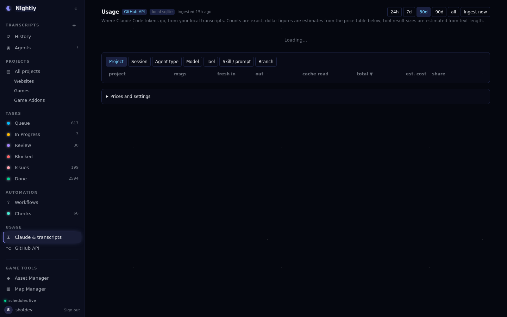

# Usage and Claude plan limits

The Usage page and the plan-usage check. Back to the [README](../README.md#usage).



`/usage` shows where your Claude Code tokens go, read from the transcript files Claude Code keeps on disk. Totals (today, 7d, 30d, all), a stacked chart over time (by token kind or by model, daily or hourly, with a table view), sortable breakdowns with share bars (project, session, agent type, model, tool, skill or prompt, branch), drill-down from any row to its sessions, and a "Where it goes" panel whose every finding comes with a concrete suggestion: cache-read versus fresh input, biggest tool results, files re-read, polling loops, idle agents, long thinking, subagent fan-out, compactions, oversized context, model mix.

- **Works without ClickHouse.** `nightly usage ingest` fills local SQLite tables and the tab reads them, so it is useful on day one. ClickHouse is an optional mirror for big histories: the tab prefers it while it answers and falls back to the local copy (with a notice) when it does not.
- **Ingest** is incremental (a per-file byte offset and mtime table; only whole lines are read) and dedupes by message id, last write wins, so a message repeated once per content block counts once. Subagent sidechain files are included and attributed to their agent type. Run it from the tab (Ingest now), `nightly usage ingest [--full] [--dir D]`, `curl -X POST "$PANEL/api/usage/ingest"` (panel session, or `Authorization: Bearer $NIGHTLY_USAGE_TOKEN`), or let the scheduler do it: setting `usageAutoIngestMinutes` (0 = off).
- **CLI**: `nightly usage ingest|summary|top <dim>|cost|insights|status|ch-setup`, all with `--json`.
- **ClickHouse**: `docker compose up -d clickhouse` (pinned official image, named volume, healthcheck, bound to 127.0.0.1 by default; credentials come from `.env`, see `.env.example`; `deploy/clickhouse/schema.sql` creates the database and `ReplacingMergeTree` tables on first start). Then set `usageChEnabled=true` (and `usageChUrl`, `usageChDb`, `usageChUser`) in Settings or the tab's settings box; the password is read from the environment variable named by `usageChPasswordEnv` (default `NIGHTLY_CLICKHOUSE_PASSWORD`) and is never stored or printed. Rows go over the HTTP interface in batches; a failed push never fails the ingest and stays queued for the next one. `usage ingest --resync` re-sends everything. Without Docker, a native ClickHouse server works the same: create the user named by `usageChUser` with that password and grant it ALL on the database (`CREATE USER ... IDENTIFIED BY ...; GRANT ALL ON nightly_usage.* TO ...`), then run `nightly usage ch-setup`. `npm test` also runs a live parity test (same numbers from ClickHouse and sqlite) when a server answers; it uses a scratch database it drops, so the user also needs `GRANT ALL ON nightly_usage_test_*.*`, and skips otherwise.
- **Settings** (database, editable in the tab): `usageDirs` (comma or newline list, default `~/.claude/projects`, env `NIGHTLY_USAGE_DIRS`), `usageProjectMode` (`basename` | `hash` | `none`: how the project label is derived from the working directory), `usageAutoIngestMinutes`, `usagePollMin` (a repeated wait-and-check call within this many minutes counts as polling, default 8), `usageBigResultTokens` (default 8000), `usagePrices`.
- **Prices are estimates.** `usagePrices` is a JSON table of USD per million tokens by model-name substring (`*` is the fallback), edited in the tab. The defaults are generic placeholders; set your own. Dollar figures are not a bill. Tool-result sizes are estimated from text length (about 3.5 characters per token, a flat 1200 per image).
- **Privacy**: only counts, ids, tool names, model, branch and the project label are stored. No message, prompt, file or tool-result text is kept; with `usageProjectMode=none` not even the project name. Nightly's own scheduled runs (turns, minutes, recorded cost) are listed next to the transcript data.
- **Tables** (`usage_*`) are created by `nightly usage ingest`, outside the Prisma schema, so `prisma db push` does not manage them.

## Claude plan usage check

[`scripts/claude-usage.sh`](scripts/claude-usage.sh) reads your Claude plan's current **5-hour** and **weekly** usage. The runner calls it before each run (and the agent between items), and it can be used on its own. Each call costs one tiny request against the 5-hour window.

```bash
# Show both windows with their reset times.
scripts/claude-usage.sh

# The same as JSON.
scripts/claude-usage.sh --json

# Exit 1 if the 5-hour window is at or over 80% or the weekly window at or over 90%.
# Exit 2 means the check itself could not read the usage; treat that as unknown, not as fine.
scripts/claude-usage.sh --check 80 90
```

Claude Code has no documented way to read plan usage outside its interactive `/usage` screen, so the script reads the rate-limit event `claude -p` reports before its answer, and falls back to looser parses if that format changes. When nothing usable comes back, it saves the raw output to `data/usage-probe-last.jsonl` (or `CLAUDE_USAGE_DEBUG_FILE`) for fixing the parse.
